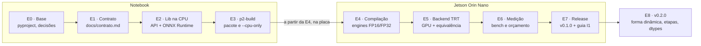

# Plano de implementação · P2 Runtime de aceleração

Atualizado em 04/11/2026

## Visão geral

P2 entrega a biblioteca Python `p2` e três comandos (`p2-build`, `p2-bench`, `p2-list`) para carregar e executar modelos TensorRT na Jetson Orin Nano sob a API fechada da 6c: `load`, `infer`, `info` e `release`. O primeiro modelo atendido é o `app-epi-1.0.0` do MOD-1, consumido por I1, e a primeira release pública é a 0.1.0.

**Escopo do MVP:** FP16 (padrão) e FP32, forma estática, lote 1, chamada síncrona, backend TensorRT na Jetson e backend de CPU (ONNX Runtime) para notebooks.

**Fora de P2:** pré e pós-processamento (letterbox, NMS, nomes de classes), mensagens no barramento e GPU gráfica de B6.

**Legenda usada no plano:**

- **[Adiado a pedido]**: item que você pediu explicitamente para deixar para depois.
- **[Sugerido para depois]**: item que o plano propõe adiar.

Referências: Arquitetura 6c, Especificação de interfaces 1.0 (seção P2) e item 8 da seção 10 ("SIS-1 detalha tipos e erros").



As etapas E0 a E3 rodam no notebook. Da E4 em diante, o trabalho depende da Jetson, e a E7 entrega a release 0.1.0. A E8 estende o P2 aos demais consumidores da 6c na release 0.2.0.

## Decisões consolidadas

Estas decisões estão fechadas e vão para `docs/decisoes.md` na etapa E0. Qualquer dúvida nova durante a implementação vira uma linha a mais nesta tabela.

| Tema | Decisão |
| --- | --- |
| Linguagem | Python 3.10.12 |
| Código | Nomes em inglês, sem comentários |
| Documentação e mensagens de erro | Em português |
| Distribuição | Wheel `p2-<versão>-py3-none-any.whl` anexado a uma release de `ods-26-2/p2`; `import p2` |
| URL da 0.1.0 | `https://github.com/ods-26-2/p2/releases/download/v0.1.0/p2-0.1.0-py3-none-any.whl` |
| Dependência obrigatória | `numpy>=1.21.6,<2` |
| Extra `cpu` | `onnxruntime>=1.19` |
| Extra `trt` | `cuda-python==12.6.*` (`cudart`); o `tensorrt` vem do JetPack, não do pip |
| Ambiente da placa | JetPack 6.2.1, L4T 36.4.7, TensorRT 10.3.0, CUDA 12.6 |
| Erros da 6c | `p2.P2Error(code, detail)` com os 5 códigos |
| Erros de uso | `ValueError` (opção desconhecida, handle já liberado) |
| `options` | Só `precision`: `"FP16"` (padrão) ou `"FP32"` |
| Entrada do `infer` | Array solto ou `{nome: array}`; float32; forma exata do `info`; tipo errado gera `INVALID_INPUT_SHAPE`; array não contíguo é copiado |
| Saída do `infer` | Tupla `({nome: ndarray}, {"latency_ms", "gpu_memory_mb"})`, com arrays copiados |
| `latency_ms` | Tempo total da chamada, incluindo as cópias entre CPU e GPU |
| `gpu_memory_mb` | Memória do handle (pesos, ativações e buffers), calculada no `load` e constante por handle |
| `engine_version` | `<engine_ref>-fp16` ou `<engine_ref>-fp32` |
| Concorrência | Trava por handle; chamadas simultâneas rodam em sequência |
| Ciclo de vida do handle | `release` idempotente; suporte a `with p2.load(...) as h:` |
| Backends | TensorRT ou CPU, escolhido automaticamente; forçável com `P2_BACKEND=trt\|ort` |
| Precisão na CPU | Só FP32. Sem `precision`, a CPU usa FP32 e o `info` informa; FP16 explícito gera `ENGINE_NOT_FOUND` |
| Pasta dos engines | `P2_ENGINE_DIR`, padrão `/opt/ods/engines/<engine_ref>/` |
| `engine_ref` | `artifact_id-artifact_version` do `metadata.json`, por exemplo `app-epi-1.0.0` |
| Ferramenta de compilação | `p2-build`, instalada com o wheel; roda no sistema da Jetson |
| Modo sem GPU | `p2-build --cpu-only` monta a pasta só com ONNX, metadados e manifesto |
| Precisões compiladas | FP16 e FP32 por padrão; `--precision` escolhe |
| TF32 | Desligado no engine FP32 |
| Memória de trabalho do compilador | 1 GB |
| Validações antes de compilar | Hash, `input_shape` e `4 + len(classes)`: qualquer divergência faz a compilação falhar |
| Engine já existente | Recusa sobrescrever; `--force` permite |
| Teste após compilar | Um `infer` com entrada zerada em cada variante |
| Logs | Módulo `logging`, logger `"p2"`, sem `print` |
| Testes | `pytest`; testes de TensorRT marcados para rodar só na placa |
| Orçamento | 1.024 MB por processo de I1, provisório; uma aplicação por vez na placa |

## Contrato da API

A API segue exatamente a assinatura fechada da 6c; o plano só detalha tipos e erros, como pede o item 8 da seção 10. Este conteúdo vira `docs/contrato.md` na etapa E1.

| Função | Entrada | Retorno | Erros |
| --- | --- | --- | --- |
| `load(engine_ref, options=None)` | `engine_ref: str`; `options: dict \| None` com `precision` | `Handle` | `ENGINE_NOT_FOUND`, `INCOMPATIBLE_VERSION`, `OUT_OF_MEMORY` |
| `infer(handle, input)` | `Handle`; `np.ndarray` ou `dict[str, np.ndarray]` | `tuple[dict[str, np.ndarray], dict[str, float]]` | `INVALID_INPUT_SHAPE`, `RUNTIME_ERROR` |
| `info(handle)` | `Handle` | `dict` com os 5 campos da 6c | — |
| `release(handle)` | `Handle` | `None` | — |

Exemplo com o `app-epi` (3 classes):

```python
import p2

h = p2.load("app-epi-1.0.0")

p2.info(h)
{
    "engine_version": "app-epi-1.0.0-fp16",
    "input_shape": {"images": [1, 3, 640, 640]},
    "output_shape": {"output0": [1, 7, 8400]},
    "precision": "FP16",
    "max_batch": 1
}

out, stats = p2.infer(h, x)
out["output0"].shape
(1, 7, 8400)
stats
{"latency_ms": 8.3, "gpu_memory_mb": 46.2}

p2.release(h)
```

Os números de `stats` são ilustrativos; os reais saem da medição na placa.

**Quando cada erro ocorre:**

| Função | `code` | Situação |
| --- | --- | --- |
| `load` | `ENGINE_NOT_FOUND` | Pasta do `engine_ref` inexistente, manifesto ausente ou variante de precisão não compilada |
| `load` | `INCOMPATIBLE_VERSION` | Versão do TensorRT no manifesto diferente da instalada |
| `load` | `OUT_OF_MEMORY` | Falha de alocação ao desserializar o engine ou criar os buffers |
| `infer` | `INVALID_INPUT_SHAPE` | Nome, forma ou tipo da entrada diferente do declarado em `info` |
| `infer` | `RUNTIME_ERROR` | Falha na cópia ou na execução na GPU |

Erros de uso, fora desses cinco casos, saem como `ValueError`: opção desconhecida, precisão inválida, handle usado depois do `release`.

Interpretação registrada: a 6c diz que `gpu_memory_mb` é "medido na chamada". O valor devolvido é a memória do handle no momento da chamada, que é constante depois do `load`.

## Pacote MODEL e manifesto

O `p2-build` lê o pacote do MOD-1 pelo `metadata.json` e grava uma pasta por `engine_ref`, com um `manifest.json` que o `load` usa para achar e validar o engine.

**Campos do `metadata.json` usados por P2:**

| Campo | Exemplo (`app-epi`) | Uso |
| --- | --- | --- |
| `artifact_id` + `artifact_version` | `app-epi` + `1.0.0` | Formam o `engine_ref` `app-epi-1.0.0` |
| `onnx_file` | `app-epi.onnx` | Arquivo a compilar |
| `hash_sha256` | `3da7aa2a…63122` | Conferido antes de compilar; vai para o manifesto |
| `input_shape` | `[1, 3, 640, 640]` | Conferido contra a entrada do ONNX |
| `classes` | 3 classes | Conferido: a saída precisa ter `4 + 3 = 7` linhas |
| `precision` | `FP32` | Precisão do ONNX; deve ser FP32 |

O `descriptor.json` não é lido. Os campos `metrics` e `dataset_version` ficam com B5 e I1.

**Pasta gerada na Jetson:**

```
/opt/ods/engines/app-epi-1.0.0/
├─ app-epi.onnx
├─ metadata.json
├─ fp16.engine
├─ fp32.engine
└─ manifest.json
```

Com `--cpu-only`, a pasta tem só `app-epi.onnx`, `metadata.json` e `manifest.json`.

**`manifest.json`:**

```json
{
  "schema_version": 1,
  "engine_ref": "app-epi-1.0.0",
  "source": {
    "onnx_file": "app-epi.onnx",
    "sha256": "3da7aa2a6b50c1aa27333990aa4450a3ef34f2e9a3d05f9367bf1b9f6d363122",
    "metadata_file": "metadata.json"
  },
  "inputs":  { "images":  { "shape": [1, 3, 640, 640], "dtype": "float32" } },
  "outputs": { "output0": { "shape": [1, 7, 8400],     "dtype": "float32" } },
  "max_batch": 1,
  "variants": {
    "FP16": { "file": "fp16.engine", "engine_version": "app-epi-1.0.0-fp16", "sha256": "…" },
    "FP32": { "file": "fp32.engine", "engine_version": "app-epi-1.0.0-fp32", "sha256": "…" }
  },
  "platform": { "jetpack": "6.2.1", "l4t": "36.4.7", "tensorrt": "10.3.0", "cuda": "12.6" },
  "build": { "tool": "p2-build 0.1.0", "built_at": "…", "tf32": false, "workspace_mb": 1024 }
}
```

Com `--cpu-only`, `variants` e `platform` ficam vazios (`{}`), e o backend de CPU executa o `onnx_file`.

## Estrutura do repositório

Todo o código fica em `ods-26-2/p2`, com o pacote em `src/p2/` e os comandos registrados como entry points do wheel.

```
p2/
├─ pyproject.toml
├─ requirements-dev.txt
├─ README.md
├─ docs/
│   ├─ decisoes.md
│   ├─ contrato.md
│   ├─ guia-integracao.md
│   ├─ orcamento.md
│   └─ depois.md
├─ src/p2/
│   ├─ __init__.py
│   ├─ errors.py
│   ├─ manifest.py
│   ├─ handle.py
│   ├─ api.py
│   ├─ backends/
│   │   ├─ base.py
│   │   ├─ ort.py
│   │   └─ trt.py
│   ├─ build/
│   │   ├─ package.py
│   │   └─ compiler.py
│   └─ cli/
│       ├─ build.py
│       ├─ bench.py
│       └─ list.py
├─ scripts/
│   └─ check_jetson.py
├─ examples/
│   └─ yolo_demo.py
├─ reports/
│   ├─ equivalencia/
│   └─ bench/
└─ tests/
    ├─ conftest.py
    ├─ helpers/yolo.py
    ├─ test_manifest.py
    ├─ test_package.py
    ├─ test_api_cpu.py
    ├─ test_errors.py
    ├─ test_yolo11n.py
    ├─ fixtures/yolo11n-1.0.0/metadata.json
    └─ jetson/
        ├─ test_trt.py
        └─ test_equivalence.py
```

| Arquivo | Responsabilidade | Etapa |
| --- | --- | --- |
| `pyproject.toml` | Nome `p2`, versão, dependências, extras `cpu` e `trt`, entry points `p2-build`, `p2-bench`, `p2-list` | E0 |
| `requirements-dev.txt` | `numpy>=1.21.6,<2`, `onnx`, `pytest`, `build` | E0 |
| `src/p2/__init__.py` | Exporta `load`, `infer`, `info`, `release`, `P2Error`, `__version__` | E2 |
| `src/p2/errors.py` | `P2Error(code, detail)` e as constantes dos 5 códigos | E2 |
| `src/p2/manifest.py` | Ler, validar e gravar o manifesto; resolver `P2_ENGINE_DIR/<engine_ref>` | E2 |
| `src/p2/handle.py` | Classe `Handle`: sessão do backend, dados do manifesto, `memory_mb`, trava, estado liberado, `with` | E2 |
| `src/p2/api.py` | `load`, `infer`, `info`, `release`; escolha do backend, validação da entrada, `latency_ms` | E2 |
| `src/p2/backends/base.py` | Interface comum: `open(manifest, precision)` devolve uma sessão com `run(inputs)`, `memory_mb` e `close()` | E2 |
| `src/p2/backends/ort.py` | Backend de CPU com ONNX Runtime | E2 |
| `src/p2/backends/trt.py` | Backend TensorRT com `cuda-python` | E5 |
| `src/p2/build/package.py` | Ler o pacote MODEL, montar o `engine_ref`, validar hash, forma e número de classes | E3 |
| `src/p2/build/compiler.py` | Compilar ONNX em engine com o TensorRT e coletar as versões da plataforma | E4 |
| `src/p2/cli/build.py` | Comando `p2-build` | E3, E4 |
| `src/p2/cli/bench.py` | Comando `p2-bench` | E6 |
| `src/p2/cli/list.py` | Comando `p2-list` | E6 |
| `scripts/check_jetson.py` | Verificação do ambiente da placa, fora do wheel | E0 |
| `examples/yolo_demo.py` | Uso completo com pré e pós-processamento, para I1 | E7 |
| `tests/conftest.py` | Gera um ONNX sintético mínimo com `onnx.helper` e pastas de engine temporárias | E2 |
| `tests/helpers/yolo.py` | Decodificação, NMS e IoU, só para os testes | E5 |

## Etapas E0 a E2: base, contrato e lib na CPU

As três primeiras etapas rodam no notebook, exceto a verificação de ambiente da E0. Ao fim da E2, I1 já consegue integrar a lib sem a placa.

### E0 · Preparação e verificação do ambiente

- [ ] Criar `pyproject.toml` com nome `p2`, versão `0.1.0`, `requires-python = ">=3.10"`, `numpy>=1.21.6,<2`, extras `cpu` e `trt` e entry points `p2-build`, `p2-bench`, `p2-list`
- [ ] Criar `requirements-dev.txt` e `README.md`
- [ ] Escrever `docs/decisoes.md` a partir da seção "Decisões consolidadas"
- [ ] Escrever `docs/depois.md` a partir da seção "Deixado para depois"
- [ ] Escrever `scripts/check_jetson.py`, que confere na placa:
  - Python 3.10.12
  - `import tensorrt` com versão 10.3.0
  - versão do numpy dentro de `>=1.21.6,<2`, porque o `apt` do Ubuntu 22.04 traz 1.21.5
  - `cudaMalloc`, `cudaMemcpy` e `cudaFree` funcionando via `cuda-python` 12.6
  - compilação de um ONNX sintético mínimo com o TensorRT
- [ ] Rodar `check_jetson.py` na placa usando o `python3` do sistema ou um venv com `--system-site-packages`, para enxergar o TensorRT do JetPack

| Saída | Onde fica | Como é usada |
| --- | --- | --- |
| `pyproject.toml`, `requirements-dev.txt`, `README.md` | Raiz do repositório | `pip install -e ".[cpu]"` no notebook; `pip install -e ".[trt]"` na Jetson |
| `docs/decisoes.md`, `docs/depois.md` | `docs/` | Referência fixa das decisões e do backlog |
| `scripts/check_jetson.py` | `scripts/`, fora do wheel | Confirma que a placa está pronta para E4 e E5 |

**Pronto quando:** `pip install -e ".[cpu]"` funcionar no notebook e o `check_jetson.py` passar na placa.

### E1 · Contrato

- [ ] Escrever `docs/contrato.md` a partir das seções "Contrato da API" e "Pacote MODEL e manifesto"
- [ ] Incluir exemplos com o `app-epi-1.0.0`: `info`, `infer` e tratamento de erro com `try`
- [ ] Enviar ao MOD-1 e ao B1

| Saída | Onde fica | Como é usada |
| --- | --- | --- |
| `docs/contrato.md` | `docs/` e registro de contratos de B1 | I1 programa contra ele; é o detalhamento pedido no item 8 da 6c |

**Pronto quando:** o MOD-1 tiver lido o contrato sem dúvidas de uso.

### E2 · Núcleo da lib e backend de CPU

- [ ] `errors.py`: `P2Error(code, detail)`, com `str(e)` no formato `CODE: detalhe`
- [ ] `manifest.py`: leitura e validação do manifesto; pasta ou manifesto ausente gera `ENGINE_NOT_FOUND`
- [ ] `handle.py`: `Handle` com trava (`threading.Lock`), estado liberado, `__enter__` e `__exit__`
- [ ] `backends/base.py`: interface comum dos backends
- [ ] `backends/ort.py`: sessão ONNX Runtime a partir do `onnx_file`; FP16 pedido explicitamente gera `ENGINE_NOT_FOUND`; `memory_mb = 0.0`
- [ ] `api.py`:
  - `load`: valida `options`, resolve o backend (`P2_BACKEND` ou automático) e abre a sessão
  - `infer`: normaliza array solto para `{nome: array}`, valida nomes, formas e float32, torna o array contíguo, mede `latency_ms` com `time.perf_counter`, devolve cópias
  - `info`: os 5 campos da 6c
  - `release`: idempotente; uso posterior gera `ValueError`
- [ ] `__init__.py`: exportações e `__version__`
- [ ] Testes: `conftest.py`, `test_manifest.py`, `test_api_cpu.py`, `test_errors.py`

| Saída | Onde fica | Como é usada |
| --- | --- | --- |
| Pacote `p2` com backend de CPU | `src/p2/` | I1 instala do branch principal e integra no notebook |
| Testes de CPU | `tests/` | `pytest` em qualquer máquina |

**Pronto quando:** `pytest` passar no notebook, cobrindo o ciclo completo, `with`, chamadas simultâneas em duas threads, `ValueError` depois do `release` e os códigos que a CPU produz (`ENGINE_NOT_FOUND`, `INVALID_INPUT_SHAPE`, `RUNTIME_ERROR`).

## Etapas E3 a E5: compilação e GPU

A E3 ainda roda no notebook; E4 e E5 exigem a Jetson. Ao fim da E5, o `app-epi-1.0.0` roda em FP16 e FP32 na GPU com a mesma API da CPU.

### E3 · `p2-build`: leitura do pacote e modo `--cpu-only`

- [ ] `build/package.py`:
  - ler o `metadata.json` da pasta informada
  - montar `engine_ref = artifact_id-artifact_version`
  - conferir o `hash_sha256` do `onnx_file`
  - conferir `input_shape` contra a entrada do ONNX
  - conferir se a saída tem `4 + len(classes)` linhas
- [ ] `cli/build.py` com a interface `p2-build <pasta-do-pacote> [--precision FP16 FP32] [--cpu-only] [--force] [--engine-dir <caminho>]`
- [ ] Com `--cpu-only`: copiar `onnx_file` e `metadata.json` e gravar o manifesto sem `variants` e `platform`
- [ ] Recusar pasta existente sem `--force`
- [ ] Mensagens de erro em português, por exemplo `hash diferente: esperado 3da7…, obtido 91c2…`
- [ ] `test_package.py`: hash errado, forma errada, número de classes errado e pasta existente

| Saída | Onde fica | Como é usada |
| --- | --- | --- |
| Comando `p2-build` | Instalado com o wheel | Prepara a pasta do engine |
| `$P2_ENGINE_DIR/app-epi-1.0.0/` (modo CPU) | Disco do notebook | `p2.load("app-epi-1.0.0")` sem GPU |

**Pronto quando:** `p2-build pacote-app-epi/ --cpu-only` gerar a pasta e `p2.load("app-epi-1.0.0")` devolver `output0` com forma `[1, 7, 8400]` no notebook.

### E4 · Compilação TensorRT

- [ ] `build/compiler.py`:
  - criar builder, network e parser ONNX do TensorRT
  - FP16: `BuilderFlag.FP16`; FP32: sem FP16 e com `BuilderFlag.TF32` desligado
  - limitar a memória de trabalho a 1 GB (`MemoryPoolType.WORKSPACE`)
  - gravar o `.engine` e calcular o `sha256` dele
  - ler nomes e formas de I/O do engine compilado
  - coletar as versões: `/etc/nv_tegra_release` (L4T), `dpkg-query -W nvidia-jetpack` (JetPack), `tensorrt.__version__`
- [ ] `cli/build.py` sem `--cpu-only`: compilar cada variante, preencher `variants` e `platform` e rodar um `infer` com entrada zerada em cada variante
- [ ] Erro de parser ou de compilação: mensagem com o erro original do TensorRT e código de saída diferente de zero
- [ ] Compilar o `yolo11n` e o `app-epi` na placa

| Saída | Onde fica | Como é usada |
| --- | --- | --- |
| `fp16.engine`, `fp32.engine`, `manifest.json` | `/opt/ods/engines/<engine_ref>/` na Jetson | Lidos pelo backend TensorRT no `load` |

**Pronto quando:** as duas variantes do `yolo11n-1.0.0` e do `app-epi-1.0.0` forem compiladas na placa, com o teste de `infer` passando.

### E5 · Backend TensorRT

- [ ] `backends/trt.py`, no `open`:
  - conferir `platform.tensorrt` contra `tensorrt.__version__`; diferente gera `INCOMPATIBLE_VERSION`
  - desserializar o engine e criar o contexto de execução
  - `cudaMalloc` de um buffer por tensor de I/O e `cudaStreamCreate`
  - `set_tensor_address` para cada tensor
  - `memory_mb` = tamanho do engine + `device_memory_size_v2` + soma dos buffers
  - falha de desserialização por memória ou de `cudaMalloc` gera `OUT_OF_MEMORY`
- [ ] `backends/trt.py`, no `run`: `cudaMemcpyAsync` da entrada, `execute_async_v3`, `cudaMemcpyAsync` das saídas, `cudaStreamSynchronize`; falha gera `RUNTIME_ERROR`
- [ ] `backends/trt.py`, no `close`: `cudaFree` dos buffers, destruição do stream, do contexto e do engine
- [ ] Buffers de saída no host pré-alocados por handle, devolvidos como cópia a cada `infer`
- [ ] `tests/jetson/test_trt.py`: ciclo completo na GPU e os 5 códigos (`INCOMPATIBLE_VERSION` alterando a versão no manifesto de uma cópia da pasta)
- [ ] `tests/helpers/yolo.py` e `tests/jetson/test_equivalence.py`: comparar CPU, TRT FP32 e TRT FP16
- [ ] Gravar o resultado em `reports/equivalencia/app-epi-1.0.0.md`

| Saída | Onde fica | Como é usada |
| --- | --- | --- |
| Backend TensorRT | `src/p2/backends/trt.py` | Escolhido automaticamente na Jetson |
| `reports/equivalencia/app-epi-1.0.0.md` | Repositório | Enviado ao MOD-1 junto com o pedido do mAP em FP16 |

**Pronto quando:** os testes de `tests/jetson/` passarem na placa.

## Etapas E6 e E7: medição e release 0.1.0

A E6 transforma os 1.024 MB provisórios em um número medido. A E7 publica a URL já informada ao MOD-1 e fecha a integração com I1.

### E6 · `p2-bench`, `p2-list` e orçamento

- [ ] `cli/bench.py` com a interface `p2-bench <engine_ref> [--precision FP16] [--duration 30m] [--warmup 50] [--out <arquivo.json>]`:
  - memória do sistema (`MemAvailable` de `/proc/meminfo`) antes do `load`, depois do `load` e no pico durante a execução
  - entrada aleatória com a forma do `info`, gerada uma vez antes do laço
  - latência p50, p95 e máxima, FPS médio e `gpu_memory_mb`
  - registro do modo de energia (`nvpmodel -q`) e das versões da plataforma
- [ ] `cli/list.py`: lista as pastas de `P2_ENGINE_DIR`, as variantes de cada uma e se a versão do TensorRT é compatível com a instalada
- [ ] Medir o `app-epi-1.0.0` em FP16 e FP32 por 30 minutos cada, com a placa em repouso
- [ ] Escrever `docs/orcamento.md` com custo fixo, pico e limite (pico × 1,3)
- [ ] Confirmar ou corrigir os 1.024 MB e avisar o MOD-1
- [ ] Testar se o limite de memória do container conta a memória alocada pelo CUDA na Jetson

| Saída | Onde fica | Como é usada |
| --- | --- | --- |
| Comandos `p2-bench` e `p2-list` | Instalados com o wheel | Medição e diagnóstico de `ENGINE_NOT_FOUND` e `INCOMPATIBLE_VERSION` |
| `reports/bench/<engine_ref>-<precisão>-<data>.json` | Repositório | Fonte dos números do orçamento |
| `docs/orcamento.md` | `docs/` | P3 aplica como limite do container de I1 |

**Pronto quando:** existir o orçamento medido do `app-epi-1.0.0` em FP16.

### E7 · Release 0.1.0 e integração com I1

- [ ] `examples/yolo_demo.py`: BGR para RGB, letterbox com preenchimento 114, `infer`, decodificação, limiar, NMS e retorno ao quadro original
- [ ] `docs/guia-integracao.md`: linha do Dockerfile, montagem de `/opt/ods/engines`, `artifact_version` vindo de `info()["engine_version"]` e tratamento de erros
- [ ] Gerar o wheel: `python -m build --wheel`
- [ ] Testar o wheel num venv limpo, no notebook e na Jetson
- [ ] Criar a tag `v0.1.0` e a release com `p2-0.1.0-py3-none-any.whl` anexado
- [ ] Acompanhar o I1 na primeira build na Jetson

| Saída | Onde fica | Como é usada |
| --- | --- | --- |
| `examples/yolo_demo.py` | `examples/` | Referência de pré e pós-processamento para I1 |
| `docs/guia-integracao.md` | `docs/` | Passo a passo para as equipes de inferência |
| Release `v0.1.0` | GitHub `ods-26-2/p2` | `pip install https://github.com/ods-26-2/p2/releases/download/v0.1.0/p2-0.1.0-py3-none-any.whl` |

**Pronto quando:** I1 rodar na Jetson com a lib instalada pela URL e publicar eventos com `artifact_version: "app-epi-1.0.0-fp16"`.

Até a E7, I1 pode testar no notebook instalando do branch principal: `pip install "p2[cpu] @ git+https://github.com/ods-26-2/p2.git"`.

## Etapa E8: v0.2.0, forma dinâmica e várias etapas

**Objetivo:** permitir que os demais consumidores da 6c usem o P2:

- I5: Whisper e VAD
- I7: OCR em dois estágios
- I2: ReID com vários recortes por chamada
- I4 e I8: modelos sem classes

A API (`load`, `infer`, `info`, `release`) não muda, e modelos estáticos, como o YOLO, se comportam exatamente como na 0.1.0. O contrato passa a ser o "Contrato P2 1.1" (`docs/contrato.md`); a spec é a `specs/ativas/009-v020-forma-dinamica-etapas.md`.

**Escopo:**

1. **Etapas como engines separados.** Cada etapa de um modelo é um `engine_ref` próprio, publicado por B5 como um pacote MODEL próprio, por exemplo `whisper-small-encoder-1.0.0` e `whisper-small-decoder-1.0.0`. O laço entre as etapas fica no componente consumidor: decodificação token a token em I5, recorte da placa antes do OCR em I7.
2. **Forma dinâmica.**
   - O `metadata.json` ganha o campo opcional `dynamic_shapes`, com `min`, `opt` e `max` por entrada. Exemplo: `"tokens": {"min": [1, 1], "opt": [1, 64], "max": [1, 448]}`
   - O `p2-build` cria um perfil de otimização do TensorRT com esses limites
   - No manifesto (`schema_version: 2`), uma dimensão dinâmica aparece como `-1` em `shape`, acompanhada de um bloco `profile` com `min`, `opt` e `max`
   - O `info` mostra `-1` nas dimensões dinâmicas, e `max_batch` passa a ser a primeira dimensão de `max`
   - O `infer` aceita qualquer forma dentro do intervalo de `min` a `max`; fora dele, lança `INVALID_INPUT_SHAPE`. As formas de saída são calculadas a cada chamada
   - Os buffers da GPU são alocados no `load` para a forma `max`, e o `gpu_memory_mb` reflete esse máximo
3. **Lote maior que 1.** Decorre do item 2. Com a primeira dimensão dinâmica, uma única chamada processa N recortes, como as pessoas para o ReID de I2 ou as placas para o OCR de I7.
4. **Tipo de dado por tensor.** Cada entrada e saída declara seu `dtype` no manifesto: `float32`, `int32`, `int64` ou `bool`. O `infer` valida o tipo declarado, em vez de exigir `float32`. Isso é necessário para os tokens do decoder do Whisper e para a entrada de taxa de amostragem do VAD, ambos em `int64`.
5. **Validação do pacote por tarefa.**
   - O `metadata.json` ganha o campo `task`, com valores `detect`, `classify`, `segment`, `ocr`, `reid`, `speech-encoder`, `speech-decoder`, `vad` ou `other`
   - A checagem `4 + len(classes)` passa a valer só para `task: detect`
   - O campo `classes` fica opcional nas demais tarefas
   - O `input_shape` aceita um dicionário `{nome: forma}` para modelos com várias entradas
6. **Compatibilidade.** Manifestos com `schema_version: 1` continuam carregando sem mudança. Um pacote sem `task` é tratado como `detect`. Modelos estáticos só com `float32` continuam gerando manifesto v1, legível pela lib 0.1.0.

**Tarefas:**

- [x] Contrato P2 1.1 em `docs/contrato.md`, com exemplos por grupo (Whisper, ReID) e formatos do pacote e do manifesto
- [x] Tipos públicos da interface: `p2.TensorArray`; `ShapeProfile` e `TensorSpec.profile` no manifesto; `Task` no pacote
- [ ] Manifesto v2: leitura e gravação (v1 para estático `float32`), `max_batch`
- [ ] `p2-build`: `task`, `input_shape` em dicionário, `dynamic_shapes`, dtypes, perfil de otimização no TensorRT
- [ ] `infer`: validação de `dtype` e de forma pelo perfil; saídas no `dtype` do tensor (CPU e TensorRT)
- [ ] Backend TensorRT: `set_input_shape` por chamada, buffers alocados em `max`, formas de saída calculadas
- [ ] `p2-build` e `p2-bench` gerando entradas com o `dtype` e a forma do perfil (`max` no teste do build, `opt` no bench)
- [ ] Testes novos (abaixo); release `v0.2.0`

**Pré-requisitos fora de P2:**

| Com quem | Pré-requisito |
| --- | --- |
| B5 e VER-4 | Whisper: exportar encoder e decoder em ONNX separados e decidir se o decoder usa cache KV. Com cache, o decoder tem mais entradas e roda mais rápido |
| B5 e INV-2 | MediaPipe (I4): não é ONNX. Converter cada submodelo (pose, mãos, rosto) para ONNX antes; cada um vira uma etapa |
| MOD-1 e B5 | Campos novos: `task` e `dynamic_shapes` são mudanças no pacote MODEL e precisam ser combinadas |
| Consumidores | Orçamento: com dois ou mais engines no mesmo processo, cada etapa precisa ser medida com `p2-bench` |

**Testes novos:**

| Onde roda | Caso |
| --- | --- |
| Notebook | ONNX sintético com eixo dinâmico |
| Notebook | Entrada `int64` |
| Notebook | Forma fora do perfil gerando `INVALID_INPUT_SHAPE` |
| Notebook | Lote de 4 numa chamada |
| Notebook | Manifesto v1 ainda carregando |
| Jetson | Whisper tiny (encoder e decoder) transcrevendo um áudio curto de ponta a ponta |

| Saída | Onde fica | Como é usada |
| --- | --- | --- |
| `docs/contrato.md` (1.1) | `docs/` e registro de contratos de B1 | Interface comum para I2, I4, I5, I7, I8 e para o pacote MODEL de B5 |
| Release `v0.2.0` | GitHub `ods-26-2/p2` | `pip install https://github.com/ods-26-2/p2/releases/download/v0.2.0/p2-0.2.0-py3-none-any.whl` |

**Pronto quando:** o Whisper tiny transcrever um áudio curto na Jetson pela API do P2, com encoder e decoder como engines separados, e os testes novos passarem.

## Testes e verificação

Os testes de CPU usam um ONNX sintético gerado na hora e rodam em qualquer máquina. Os de TensorRT ficam em `tests/jetson/`, marcados com `@pytest.mark.jetson`, e só rodam na placa.

| Conjunto | Onde roda | O que cobre |
| --- | --- | --- |
| `test_manifest.py` | Notebook | Leitura e validação do manifesto, `P2_ENGINE_DIR`, pasta ausente |
| `test_package.py` | Notebook | `engine_ref`, hash, forma, número de classes, pasta existente, `--cpu-only` |
| `test_api_cpu.py` | Notebook | Ciclo completo, array solto e dict, `with`, trava em duas threads, cópia das saídas |
| `test_errors.py` | Notebook | `ENGINE_NOT_FOUND`, `INVALID_INPUT_SHAPE`, `RUNTIME_ERROR`, `ValueError` de uso |
| `test_yolo11n.py` | Notebook e Jetson | Modelo YOLO real com 80 classes COCO, do pacote ao `infer` (ver "Teste com o yolo11n") |
| `jetson/test_trt.py` | Jetson | Ciclo completo na GPU, FP16 e FP32, os 5 códigos, `gpu_memory_mb > 0` |
| `jetson/test_equivalence.py` | Jetson | Detecções iguais entre CPU, TRT FP32 e TRT FP16 |

**Tolerâncias de equivalência**, medidas sobre detecções depois de decodificação e NMS, com a CPU FP32 como referência:

| Engine | IoU mínima | Diferença máxima de confiança |
| --- | --- | --- |
| TRT FP32 | 0,98 | 0,01 |
| TRT FP16 | 0,95 | 0,03 |

Detecções a ±0,03 do limiar de confiança são ignoradas, porque podem aparecer ou sumir só por arredondamento. As tolerâncias são um ponto de partida: depois da primeira execução, fixe os limites com base nas diferenças reais e alguma folga.

**Dados de teste:**

- Cerca de 20 imagens com pessoas e EPI em `tests/fixtures/imagens/`.
- Pacote de teste do `yolo11n` em `tests/fixtures/yolo11n-1.0.0/`, descrito na subseção abaixo. Os arquivos `.onnx` ficam fora do git.

### Teste com o yolo11n

O `yolo11n` de teste (ONNX gerado por você, 80 classes COCO) é o primeiro modelo YOLO real que passa pela lib inteira, antes do `app-epi` chegar. A saída dele é `output0` com forma `[1, 84, 8400]` (4 + 80 classes).

**Pacote de teste** em `tests/fixtures/yolo11n-1.0.0/`:

| Arquivo | No git? | Conteúdo |
| --- | --- | --- |
| `metadata.json` | Sim | `artifact_id: "yolo11n"`, `artifact_version: "1.0.0"`, `onnx_file: "model.onnx"`, `input_shape: [1, 3, 640, 640]`, `precision: "FP32"`, `hash_sha256: "f3f88a57b89f447e639b86279cdb0c636719f8bf7fefab8f3e27c44536e48de1"` e `classes` com os 80 nomes COCO, copiados do campo `names` dos metadados do próprio ONNX |
| `model.onnx` | Não (`.gitignore`) | O seu `yolo11n.onnx`, 10,2 MB. Sem o arquivo, os testes deste conjunto são pulados com `pytest.skip` |

**Manifesto esperado.** O manifesto que você enviou usa os nomes de campo da primeira proposta (`source_onnx`, `built_with`). O `p2-build` grava no formato da seção "Pacote MODEL e manifesto", então o teste compara com esta versão:

```json
{
  "schema_version": 1,
  "engine_ref": "yolo11n-1.0.0",
  "source": {
    "onnx_file": "model.onnx",
    "sha256": "f3f88a57b89f447e639b86279cdb0c636719f8bf7fefab8f3e27c44536e48de1",
    "metadata_file": "metadata.json"
  },
  "inputs":  { "images":  { "shape": [1, 3, 640, 640], "dtype": "float32" } },
  "outputs": { "output0": { "shape": [1, 84, 8400],    "dtype": "float32" } },
  "max_batch": 1,
  "variants": {
    "FP16": { "file": "fp16.engine", "engine_version": "yolo11n-1.0.0-fp16", "sha256": "…" },
    "FP32": { "file": "fp32.engine", "engine_version": "yolo11n-1.0.0-fp32", "sha256": "…" }
  },
  "platform": { "jetpack": "6.2.1", "l4t": "36.4.7", "tensorrt": "10.3.0", "cuda": "12.6" },
  "build": { "tool": "p2-build 0.1.0", "built_at": "…", "tf32": false, "workspace_mb": 1024 }
}
```

No modo `--cpu-only`, o esperado é o mesmo com `variants` e `platform` vazios. Os campos `built_at` e os `sha256` dos engines são conferidos só quanto ao formato, porque mudam a cada compilação.

**Casos de `tests/test_yolo11n.py`:**

| # | Onde roda | Caso | Esperado |
| --- | --- | --- | --- |
| 1 | Notebook | `p2-build tests/fixtures/yolo11n-1.0.0 --cpu-only` | Manifesto igual ao esperado, com `variants` e `platform` vazios |
| 2 | Notebook | `p2.load("yolo11n-1.0.0")` na CPU e `info` | `engine_version: "yolo11n-1.0.0-fp32"`, `precision: "FP32"`, formas `[1, 3, 640, 640]` e `[1, 84, 8400]`, `max_batch: 1` |
| 3 | Notebook | `infer` com entrada zerada | `output0` com forma `(1, 84, 8400)` e tipo float32; `stats` com as duas chaves |
| 4 | Notebook | `infer` com uma imagem com pessoa, após BGR→RGB e letterbox 114 | Pelo menos uma detecção da classe 0 (`person`) com confiança ≥ 0,5, após decodificação e NMS de `helpers/yolo.py` |
| 5 | Notebook | `p2.load("yolo11n-1.0.0", {"precision": "FP16"})` na CPU | `P2Error` com `ENGINE_NOT_FOUND` |
| 6 | Jetson | `p2-build tests/fixtures/yolo11n-1.0.0` | Manifesto igual ao esperado; `fp16.engine` e `fp32.engine` existem; `platform.tensorrt` igual a `10.3.0` |
| 7 | Jetson | `load` sem `options` e com `FP32` | `engine_version` `yolo11n-1.0.0-fp16` e `yolo11n-1.0.0-fp32`, respectivamente |
| 8 | Jetson | `infer` em cada variante | `output0` com forma `(1, 84, 8400)`; `gpu_memory_mb > 0` |
| 9 | Jetson | Mesmas imagens na CPU, TRT FP32 e TRT FP16 | Dentro das tolerâncias de equivalência acima |

Os casos 1 a 5 entram na E3 (depois do `--cpu-only`); os casos 6 a 9 entram na E5 e usam a marca `@pytest.mark.jetson`.

**Medição de memória (E6):** com a placa em repouso, anote a memória em uso antes do processo, depois do `load` e no pico de 30 minutos de inferência. O custo fixo é a segunda medida menos a primeira; o limite do componente é o pico × 1,3. O `gpu_memory_mb` do `infer` mede só o handle e não substitui essa medição.

## Pendências com outras equipes

Nenhuma destas pendências bloqueia o código das etapas E0 a E6. Todas precisam estar resolvidas antes da E7.

| Com quem | Pendência | Necessária em |
| --- | --- | --- |
| P3 | Montagem de `/opt/ods/engines` como somente leitura no container de I1 | E7 |
| P3 | Imagem base com TensorRT 10.3 que vai no `FROM` do Dockerfile de I1 | E7 |
| B5 / MOD-1 | Canal por onde o pacote MODEL chega (registro de B5 ou release no repositório deles) | E4 |
| B5 / MOD-1 | Valor oficial do mAP@0,5: 0,936 (email) ou 0,9517 (`metadata.json`) | E5 |
| B5 / MOD-1 | Medição do mAP com o engine FP16, para registrar a perda junto com a escolha de precisão | Depois da E5 |
| MOD-1 | Correção no texto enviado: o `app-epi` sai com `[1, 7, 8400]`, não `[1, 84, 8400]` | E1 |
| B5 / VER-4 | Export do Whisper em encoder e decoder separados; decisão sobre o cache KV | E8 |
| B5 / INV-2 | Conversão dos submodelos do MediaPipe para ONNX | E8 |
| MOD-1 / B5 | Acordo sobre os campos novos do pacote MODEL (`task`, `dynamic_shapes`, `input_shape` em dicionário) | E8 |
| I2, I4, I5, I7, I8 | Leitura do Contrato P2 1.1 e medição de cada etapa com `p2-bench` | E8 |

## Deixado para depois

Cinco itens ficaram fora do MVP a seu pedido explícito; três deles entraram na E8 (v0.2.0). Os demais são adiamentos sugeridos pelo plano. Nenhum deles muda a API de E1: todos acrescentam variantes ao manifesto ou etapas novas.

| Item | Origem | O que envolve |
| --- | --- | --- |
| CI no GitHub Actions | **[Adiado a pedido]** | Rodar os testes de CPU a cada push e gerar e anexar o wheel automaticamente a cada tag |
| INT8 | **[Adiado a pedido]** | Dataset de calibração de B5, variante `INT8` no manifesto e medição da perda de acurácia; avaliar só se o FP16 ficar lento |
| Forma dinâmica | **[Em andamento na E8]** | Perfis de otimização no `p2-build` e formas com faixa no manifesto e no `info` |
| Lote maior que 1 | **[Em andamento na E8]** | Primeira dimensão dinâmica; `max_batch` = `max[0]` |
| Modelos com várias etapas | **[Em andamento na E8]** | Um `engine_ref` por etapa (Whisper de I5, OCR de I7) |
| Vários perfis por engine | [Sugerido para depois] | Mais de um perfil de otimização (por exemplo lote 1 e lote 16) e escolha do perfil no `infer` |
| Tensores residentes na GPU | [Sugerido para depois] | Manter tensores na GPU entre chamadas (cache KV do decoder do Whisper) sem copiar para a CPU; exige função nova, fora da 6c |
| Carregamento sob demanda | [Sugerido para depois] | Política de quais modelos ficam residentes, a partir dos números de E6 |
| Telemetria do dispositivo | [Sugerido para depois] | Expor temperatura, clock e memória da placa, que a 6c permite a P2 sem virar pipeline gráfico |
| Orçamento das outras builds | [Sugerido para depois] | Medir cada modelo novo de B5 com `p2-bench` e acrescentar linhas em `docs/orcamento.md` |
| Busca no registro de B5 | [Sugerido para depois] | `p2-build` baixar o pacote pela URL do registro, em vez de receber um caminho local |

## Riscos e pontos de atenção

Os riscos mais prováveis estão no ambiente da placa e na conta de memória, não no código da lib.

| Risco | Efeito | Mitigação |
| --- | --- | --- |
| numpy 1.21.5 do `apt` convivendo com o 1.x instalado pelo `pip` | O TensorRT carrega uma versão e a lib outra | `check_jetson.py` confere a versão vista por `import tensorrt` (E0) |
| `cuda-python` diferente de 12.6 | Falha ao carregar o `cudart` | Fixar `cuda-python==12.6.*` no extra `trt` |
| Contexto CUDA e bibliotecas custam centenas de MB por processo | O orçamento real fica bem acima do `gpu_memory_mb` | Medir o processo inteiro com `p2-bench` (E6) |
| Limite de memória do Docker pode não contar a memória do CUDA | O limite de 1.024 MB não é aplicado de fato | Testar na placa durante a E6 |
| Mudança de JetPack ou TensorRT por P1 | Todos os engines geram `INCOMPATIBLE_VERSION` | Rodar `p2-build --force` de novo; `p2-list` mostra quais estão incompatíveis |
| Throttling térmico | Queda de FPS sem erro | Benchmark de 30 minutos e registro do `nvpmodel` (E6) |
| Perda de acurácia em FP16 | Detecções piores que o mAP validado | Teste de equivalência (E5) e mAP em FP16 medido por B5 |
| Esquecer a conversão BGR para RGB em I1 | Acurácia cai sem nenhum erro | Destacar no `guia-integracao.md` e no `yolo_demo.py` (E7) |